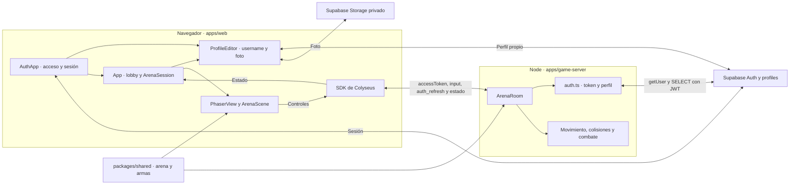
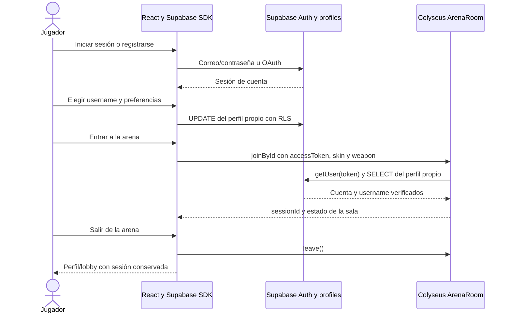
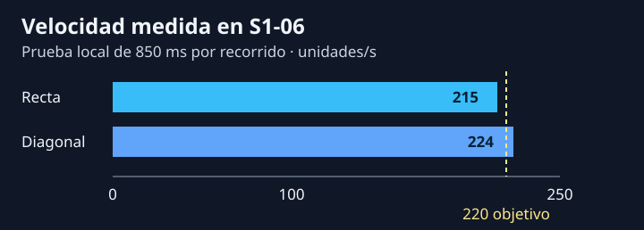

# Documentación técnica de TAP-WAR

Manual técnico de la implementación. Consulta el [estado de validación](docs/estado-actual.md) para pruebas y pendientes, y la [guía de Supabase](docs/autenticacion-supabase.md) para preparar cuentas, perfiles y almacenamiento.

- [Arquitectura y arranque](#arquitectura-y-arranque)
- [Mapa de archivos](#mapa-de-archivos)
- [Entrada y salida de la sala](#entrada-y-salida-de-la-sala)
- [Movimiento, apuntado y sincronización](#movimiento-apuntado-y-sincronización)
- [Geometría y colisiones](#geometría-y-colisiones)
- [Combate y ciclo de partida](#combate-y-ciclo-de-partida)
- [Autenticación con Supabase](#autenticación-con-supabase)
- [Créditos de Arte y Audio](#créditos-de-arte-y-audio)
- [Verificación y diagnóstico](#verificación-y-diagnóstico)
- [Cómo mantener el manual](#cómo-mantener-el-manual)

## Arquitectura y arranque

TAP-WAR es un monorepo con dos aplicaciones Node y una carpeta de datos compartidos. **React** maneja la interfaz y el ciclo de la conexión. **Phaser** captura los controles y dibuja la arena. **Colyseus** valida las entradas, decide posiciones, colisiones y combate, y distribuye el estado oficial. Cada pestaña entra a la misma sala local y obtiene un identificador de sesión propio.



Usa Node.js 24. Las versiones principales están en el [README](README.md#tecnologías-y-versiones) y las exactas en los lockfiles. El servidor usa Colyseus **0.17.11**, el navegador usa `@colyseus/sdk` **0.17.43** y el esquema usa `@colyseus/schema` **4.0.31**. Cada aplicación instala sus dependencias con `npm ci` desde su propia carpeta. Ambas incluyen `@supabase/supabase-js` 2.119.2. Copiar sus `.env.example` a `apps/web/.env.local` y `apps/game-server/.env`, y completar URL y publishable key. El servidor carga `.env` al ejecutar `npm run dev`; los archivos locales se ignoran en Git.

Desde la raíz, abre dos terminales de PowerShell:

| Terminal del servidor | Terminal del cliente |
| --- | --- |
| `Set-Location apps/game-server` | `Set-Location apps/web` |
| `npm ci` | `npm ci` |
| `npm run dev` | `npm run dev` |

Colyseus escucha en `127.0.0.1:2567`. Su ruta `/health` devuelve `{"ok":true}`. Abre http://localhost:5174. Inicia sesión con una cuenta, elige username y preferencias y pulsa **Entrar a la arena**. Para dos cuentas distintas utiliza contextos de navegador independientes, ya que las pestañas del mismo origen comparten sesión de Supabase. El puerto de Vite sirve la interfaz y el 2567 sirve la conexión de juego.

## Mapa de archivos

### Servidor y datos compartidos

| Archivo | Responsabilidad |
| --- | --- |
| [apps/game-server/src/auth.ts](apps/game-server/src/auth.ts) | Verifica el token con Auth, consulta el perfil propio con RLS y obtiene nombre, UUID privado y vencimiento. |
| [apps/game-server/src/index.ts](apps/game-server/src/index.ts) | Registra el tipo de sala `arena`, expone `/health` y `/api/rooms`, sirve el cliente estático opcional (`STATIC_DIR`) y aplica cabeceras de seguridad/CORS/rate-limit. |
| [apps/game-server/src/rooms/ArenaMaps.ts](apps/game-server/src/rooms/ArenaMaps.ts) | Mapea capacidades (`4`, `10`, `20`) a tamaños de mapa (`small`, `medium`, `large`), genera códigos únicos de 6 caracteres y normaliza nombres/códigos. |
| [apps/game-server/src/rooms/ArenaRoom.ts](apps/game-server/src/rooms/ArenaRoom.ts) | Verifica access token y perfil Supabase; gestiona salas públicas/privadas, inicio manual del anfitrión, movimiento analógico/digital, combate, pickups, reaparición y persistencia. |
| [apps/game-server/src/rooms/ArenaState.ts](apps/game-server/src/rooms/ArenaState.ts) | Define el esquema de red. `Player` incluye identidad, posición, skin, armas, munición, vida, bajas, muertes y emotes. `ArenaState` incluye metadatos de sala (`roomCode`, `roomName`, `mapSize`, `maxPlayers`, `isPrivate`), `hostId`, jugadores, balas, pickups y resultados. |
| [apps/game-server/src/rooms/ArenaInput.ts](apps/game-server/src/rooms/ArenaInput.ts) | Valida movimiento continuo en `[-1, 1]`, ángulo en `[-π, π)` y `shoot` booleano opcional. |
| [apps/game-server/src/rooms/ArenaCollision.ts](apps/game-server/src/rooms/ArenaCollision.ts) | Calcula una posición válida según el radio, los bordes y los rectángulos del mapa activo. |
| [packages/shared/arena.json](packages/shared/arena.json) | Define las configuraciones de mapa `small` (`1024×768`), `medium` (`1600×1152`) y `large` (`2240×1600`), apariciones, pickups y obstáculos para ambas aplicaciones. |
| [package.json](apps/game-server/package.json) y [package-lock.json](apps/game-server/package-lock.json) | Declaran las dependencias del servidor, el comando de desarrollo con carga de .env y modo watch y la instalación reproducible. |
| [tsconfig.json](apps/game-server/tsconfig.json) y [.gitignore](apps/game-server/.gitignore) | Configuran TypeScript en modo NodeNext, el chequeo estricto y los decoradores de Colyseus. Git ignora las dependencias instaladas. |

### Cliente web

| Archivo | Responsabilidad |
| --- | --- |
| [apps/web/index.html](apps/web/index.html) | Declara `#root`, carga el favicon e inicia el módulo `main.tsx`. |
| [apps/web/src/main.tsx](apps/web/src/main.tsx) | Monta AuthApp en `#root` bajo `StrictMode` e importa los estilos globales. |
| [apps/web/src/auth/AuthApp.tsx](apps/web/src/auth/AuthApp.tsx) y [supabase.ts](apps/web/src/auth/supabase.ts) | Acceso por correo/Google, GitHub opcional, sesión, carga de perfil y logout; cliente Supabase con PKCE. |
| [apps/web/src/auth/ProfileEditor.tsx](apps/web/src/auth/ProfileEditor.tsx), [account.ts](apps/web/src/auth/account.ts) y [ProfileAvatar.tsx](apps/web/src/auth/ProfileAvatar.tsx) | Paso inicial de username, edición posterior, preparación/subida/limpieza de foto y visualización con URL firmada. |
| [apps/web/src/App.tsx](apps/web/src/App.tsx) | Muestra lobby con preferencias, creación/unión a salas públicas o privadas por código y listado de salas abiertas. `ArenaSession` coordina la sala, barra superior, pantalla completa, controles táctiles y resultados. |
| [apps/web/src/game/PhaserView.tsx](apps/web/src/game/PhaserView.tsx) | Crea una instancia de Phaser por mapa, pasa los jugadores/controles táctiles/eventos de mando a la escena y destruye el juego al desmontarse. |
| [apps/web/src/game/ArenaScene.ts](apps/web/src/game/ArenaScene.ts) | Renderiza mapas pequeño (`arena-desert.png`) o mediano/grande (`tilemap-desert.png` + cámara seguidora + minimapa), captura teclado/ratón, mando (Gamepad API) y entrada táctil, y sincroniza jugadores. |
| [apps/web/src/game/TouchControls.tsx](apps/web/src/game/TouchControls.tsx), [gamepad.ts](apps/web/src/game/gamepad.ts) y [arenaMaps.ts](apps/web/src/game/arenaMaps.ts) | Joysticks táctiles gemelos para móvil/tablet, lectura normalizada de mandos USB/Bluetooth y definición compartida de capacidades/mapas. |
| [index.css](apps/web/src/index.css) y [App.css](apps/web/src/App.css) | El primero aplica estilos globales. El segundo define la interfaz del lobby y del juego y sí se importa desde `App.tsx`. |
| [public/assets/](apps/web/public/assets/) y [src/assets/](apps/web/src/assets/) | `public/assets/characters/` y `public/assets/maps/` contienen los sprites exportados y el fondo de la arena; `public/` conserva el favicon. |
| [package.json](apps/web/package.json) y [package-lock.json](apps/web/package-lock.json) | Declaran React, Phaser, el SDK, las herramientas de desarrollo y los comandos de Vite, compilación y lint. |
| [vite.config.ts](apps/web/vite.config.ts) | Activa el plugin de React y permite servir `packages/shared/` durante el desarrollo. |
| [tsconfig.json](apps/web/tsconfig.json), [tsconfig.app.json](apps/web/tsconfig.app.json) y [tsconfig.node.json](apps/web/tsconfig.node.json) | Separan la configuración del navegador y la de Vite en Node. La del navegador permite importar el JSON de la arena. |
| [eslint.config.js](apps/web/eslint.config.js), [.gitignore](apps/web/.gitignore) y [README.md](apps/web/README.md) | Configuran el lint, las exclusiones de Git y los comandos del cliente. |

### Archivos del repositorio

| Ruta | Uso |
| --- | --- |
| [README.md](README.md) | Presentación, tecnologías y arranque rápido. |
| [docs/](docs/) | Contrato de red, pruebas de aceptación, acuerdos, arte, planificación y flujo del equipo. |
| [.github/](.github/) | Plantillas para describir tareas y verificar pull requests. |
| [prueba-phaser/](prueba-phaser/) | Práctica independiente. Su `index.html` carga Phaser y `juego.js` contiene la escena de aprendizaje. Su README describe cómo ejecutarla. |

## Entrada y salida de la sala



- `AuthApp` restaura la sesión y carga el perfil por UUID. Una cuenta sin username debe completarlo antes de entrar; todos lo eligen independientemente del proveedor.
- Un paso inicial pide username antes de mostrar el lobby. Mi perfil permite editar username/foto; el lobby conserva personaje, arma y mira. Guardar y entrar actualiza primero las preferencias; un error de formato o unicidad al elegir el nombre impide completar el perfil. El servidor obtiene el nombre del perfil, nunca de `name` o `userId` enviados sin verificar.
- `index.ts` crea `arena-local`; `autoDispose = false` conserva la sala vacía. El máximo coincide con las cuatro apariciones. `Player.id` es `client.sessionId`, mientras el UUID de Supabase queda en una asociación privada del servidor.
- Salir de arena conserva la sesión de cuenta. Cerrar sesión desmonta el juego y cierra la conexión antes de cerrar la sesión local de Supabase. La reconexión automática de Colyseus sigue desactivada.
- Al renovar el token, el cliente envía `auth_refresh`; el servidor verifica que pertenece a la misma cuenta. Si vence sin renovación o recibe una renovación inválida, cierra con 4001. No se sincronizan tokens ni correos. El [contrato](docs/contrato-cliente-servidor.md) define los detalles.
- La limpieza de conexiones y canvas se conserva al cambiar de pantalla. Las pruebas de cuenta real, partidas y renovación prolongada se registran en el estado de validación.

## Movimiento, apuntado y sincronización

### Qué cruza la red

```json
{ "moveX": 1, "moveY": -1, "aimAngle": 0, "shoot": true }
```

El mensaje `input` expresa dirección y ángulo. Cada eje acepta `-1`, `0` o `1`. La derecha y abajo son positivas. El ángulo usa radianes en `[-π, π)`. El servidor obtiene la identidad de la conexión y extrae los tres campos requeridos y `shoot` opcional, que debe ser booleano. Si falta algún campo requerido o algún valor es inválido, descarta el mensaje entero. Si se adjuntan coordenadas, quedan fuera de la entrada validada.

```json
{ "id": "ejemplo", "name": "Luna", "x": 240, "y": 160, "aimAngle": 0 }
```

El estado oficial contiene un objeto como ese por jugador. Colyseus envía el estado inicial y después parches. `ArenaSession` convierte el mapa de jugadores en una lista. `applyPlayers` conserva una figura por ID, actualiza su posición y rotación, y destruye las figuras cuyos IDs ya no existen. El cliente renderiza el estado recibido directamente. El nombre viaja con el estado y se usa para dibujar la etiqueta de cada figura.

### Controles y simulación

1. `ArenaScene.startControls` lleva un conjunto de teclas presionadas. Resta A a D y W a S para obtener cada eje. Usa `getWorldPoint` para pasar del cursor en el canvas a coordenadas del mundo y calcula el ángulo desde el centro del jugador propio. Si los puntos coinciden, conserva el último ángulo.
2. Con foco, la escena envía la entrada cada 50 ms. Al soltar una tecla envía enseguida los ejes restantes. Al perder el foco u ocultar la pestaña borra las teclas y envía ambos ejes en cero.
3. `ArenaRoom.onMessage` valida antes de actualizar el reloj y el ángulo. `simulate` usa la última dirección vigente. Al vencer los 300 ms elimina esa entrada y conserva el ángulo sincronizado.
4. Cada paso calcula la distancia con el tiempo transcurrido. Dividir los dos ejes entre la longitud del vector mantiene la misma rapidez al ir en diagonal. La posición solo cambia después de resolver la colisión.

Extracto simplificado de `ArenaRoom.ts` para registrar una entrada válida (el código completo también filtra muerte, pausa y fin de partida):

```ts
const input = parseArenaInput(message)
const player = this.state.players.get(client.sessionId)
if (!input || !player) return

this.inputs.set(client.sessionId, {
    ...input,
    receivedAt: performance.now(),
})
player.aimAngle = input.aimAngle
```

| Reloj | Intervalo nominal | Responsabilidad |
| --- | --- | --- |
| Envío de entradas | 50 ms, 20 Hz | Phaser envía intención mientras la pestaña tiene foco. |
| Simulación | 1000 / 30 ms, 30 Hz | La sala integra el movimiento a 220 unidades/s y resuelve colisiones. |
| Publicación | 50 ms, 20 Hz | Colyseus transmite los cambios del esquema. |
| Caducidad | 300 ms | El siguiente paso de simulación deja de aplicar una entrada vencida. |

Consulta las reglas del protocolo y los ejemplos de valores inválidos en el [contrato cliente-servidor](docs/contrato-cliente-servidor.md).

## Geometría y colisiones

La geometría vigente se define en [arena.json](packages/shared/arena.json): mundo de **1024 × 768**, radio de movimiento **14**, cuatro apariciones y nueve rectángulos (cuatro muros perimetrales y cinco obstáculos interiores). El bloque central empieza en `(448, 320)` y mide **128 × 128**. Los cuerpos de jugadores pueden superponerse. El radio de impacto de proyectiles es **30** en `ArenaRoom.ts`, independiente del radio de movimiento. Los diagramas antiguos del sprint no sustituyen el JSON actual.

`moveInsideArena` divide el desplazamiento en pasos de como máximo medio radio. Limita el centro a los bordes y prueba X e Y por separado para permitir el deslizamiento. Para cada rectángulo obtiene el punto más cercano al centro del círculo. Si la distancia al cuadrado es menor que el radio al cuadrado, el paso en ese eje se descarta. El contacto tangente está permitido.

```ts
const nextX = clamp(x + stepX, radius, arena.width - radius)
if (!overlapsObstacle(nextX, y)) x = nextX

const nextY = clamp(y + stepY, radius, arena.height - radius)
if (!overlapsObstacle(x, nextY)) y = nextY
```

En Phaser, `setOrigin(0)` alinea cada rectángulo con la misma esquina que usa el servidor. Cuando se cambie el mapa, edita `arena.json` y comprueba las apariciones, los bordes y el obstáculo en dos pestañas.

## Combate y ciclo de partida

El servidor inicia `playing` desde `waiting` al alcanzar dos participantes. La ronda dura 180 segundos o termina con 10 bajas; al vencer el tiempo compara bajas y permite empate. Si quedan menos de dos durante el combate, vuelve a espera. La reaparición tarda 3 segundos y elige la aparición más alejada del rival vivo más cercano.

Las diez armas de `weapons.json` incluyen ocho de fuego y dos de melé. El servidor resuelve cadencia, munición y daño; al agotarse la munición equipa el respaldo melé. `pause` controla una pausa compartida, `emote` acepta `dots`/`alert` y `rematch` reinicia desde resultados con al menos dos jugadores. El [contrato actual](docs/contrato-cliente-servidor.md) detalla los mensajes y el esquema.

## Autenticación con Supabase

Supabase administra las credenciales en auth.users. public.profiles guarda username, preferencias, fechas y avatar_path. El perfil nuevo empieza con username NULL. El nombre admite de 3 a 20 letras ASCII, números y guion bajo, y tiene unicidad mediante lower(username).

El flujo es acceso → elección inicial de username → lobby. Mi perfil permite editar el username y gestionar la foto; el lobby conserva personaje, arma y mira. La imagen es opcional, privada, se recorta a 512 × 512 y se guarda en WebP. Los enlaces firmados se generan al mostrarla y no se almacenan en profiles ni se sincronizan con la arena.

Las migraciones de supabase/migrations definen esquema, restricciones, RLS, permisos y el bucket. La [guía de Supabase](docs/autenticacion-supabase.md) documenta su aplicación y el modelo de acceso. Las pruebas SQL de perfiles obtuvieron PASS con identidades simuladas. Además hay nueve pruebas de servidor y once de cliente; los casos reales pendientes se enumeran en el [estado actual](docs/estado-actual.md).

GitHub requiere activar el proveedor y VITE_GITHUB_AUTH_ENABLED. SMTP, recuperación y la pantalla de cambio de contraseña quedan pendientes. La demostración sin SMTP permite desactivar Confirm email; para registros públicos se requiere verificación y envío configurado. La contraseña mínima del proyecto es de ocho caracteres.

La interfaz conserva panel morado #3d2e4f, botones terracota #c85a3f, tonos arena y pixel art desértico.

## Créditos de Arte y Audio

- **Paquete base**: Kenney – *Desert Shooter Pack* (v1.0, 2024; distribuido por Kenney, `www.kenney.nl`, patrocinado por GameMaker).
- **Licencia**: Creative Commons CC0 1.0 Universal (`http://creativecommons.org/publicdomain/zero/1.0/`). Copia íntegra conservada en [docs/art-sources/License.txt](docs/art-sources/License.txt).
- **Recursos integrados en `apps/web/public/assets/`**:
  - **4 Skins jugables** (`fox`, `squirrel`, `mouse`, `rabbit`): cada skin cuenta con `player-<skin>-idle.png` (`128 × 128 px`, Nearest Neighbor 400%), `player-<skin>-walk.png` (`256 × 128 px`, 2 cuadros a 8 FPS) y `player-<skin>-dead.png` (`128 × 128 px`), generados desde `PNG/Players/Tilemap/tilemap_packed.png` (filas 0 a 3).
  - **10 Armas (8 de fuego + 2 cuerpo a cuerpo) en 2 variantes (`orange` y `blue`)** ([packages/shared/weapons.json](packages/shared/weapons.json)):
    - `apps/web/public/assets/weapons/weapon-<id>-<orange|blue>.png` (`128 × 128 px`, Nearest Neighbor 5×) para `pistol` (`12` balas), `revolver` (`6`), `smg` (`24`), `sniper` (`5`), `launcher` (`4`), `rifle` (`15`), `plasma` (`10`), `shotgun` (`6`), `knife` (`tile_0008`/`0018`, daño `50`, rango `58 px`, arco `110°`) y `axe` (`tile_0009`/`0019`, daño `100`, rango `86 px`, arco `140°`).
    - **Munición limitada y respaldo melé**: al agotarse las balas de un arma de fuego (`ammo <= 0`), el servidor cambia automáticamente a `lastMeleeWeapon` (`knife` por defecto, o `axe` si se recogió/eligió) y el cliente reproduce [sounds/error-a.ogg](apps/web/public/assets/sounds/error-a.ogg). `knife` no aparece como pickup en el mapa.
    - Las armas cuerpo a cuerpo (`isMelee: true`) validan rango, arco angular y línea de visión contra obstáculos en el servidor, ocultan el puntero de mira en el cliente y reproducen animación de tajo en arco con estela y sonido [sounds/fall-a.ogg](apps/web/public/assets/sounds/fall-a.ogg).
    - Grupo `orange`: skins `fox` y `squirrel`; grupo `blue`: skins `mouse` y `rabbit`.
  - **Proyectiles y casquillos** (`apps/web/public/assets/characters/`):
    - [characters/bullet-small.png](apps/web/public/assets/characters/bullet-small.png) (`Tiles/Tiles/tile_0225.png` rotado a la derecha, `64 × 64 px`): usado por armas pequeñas (`pistol`, `revolver`, `smg`) y los 3 perdigones de `shotgun` (`18 px * scale`).
    - [characters/bullet-heavy.png](apps/web/public/assets/characters/bullet-heavy.png) (`Interface/Tiles/tile_0058.png` rotado a la derecha, `64 × 64 px`): usado por armas grandes (`rifle`, `sniper`, `launcher`, `plasma`) (`16 px * scale`).
    - [characters/shell-small.png](apps/web/public/assets/characters/shell-small.png) (`tile_0225.png`, `14 px`) y [characters/shell-shotgun.png](apps/web/public/assets/characters/shell-shotgun.png) (`Interface/Tiles/tile_0076.png`, `16 px`): casquillos eyectados con caída y rebote tras disparar armas grandes o escopeta.
  - **16 Miras / punteros y barra de vida UI** (`apps/web/public/assets/ui/`):
    - `crosshair-<id>-<orange|blue>.png` (`64 × 64 px`, Nearest Neighbor 2×, filas 2 y 3 de `PNG/Weapons/Tiles/`): puntero dinámico según el arma equipada con estilo seleccionable en el lobby (**Con contorno** por defecto / **Sin contorno**), limitado a un radio máximo de `270 px` alrededor del jugador local (`MAX_AIM_RADIUS = 270`) con bloqueo de cursor (*Pointer Lock*) y menú de `PAUSA` al pulsar `ESC`.
    - `hp-bar-frame.png`, `hp-bar-fill.png` y `hp-bar-fill-blue.png` (`192 × 64 px`, Nearest Neighbor 4× desde `PNG/Interface/Tiles/`).
    - [ui/emote-dots.png](apps/web/public/assets/ui/emote-dots.png), [ui/emote-alert.png](apps/web/public/assets/ui/emote-alert.png) y [ui/emote-skull.png](apps/web/public/assets/ui/emote-skull.png) (`64 × 64 px`, globos `...`, `!` y calavera flotante al ser derrotado).
    - [ui/icon-bullet.png](apps/web/public/assets/ui/icon-bullet.png) (`tile_0058.png`) y [ui/icon-shell.png](apps/web/public/assets/ui/icon-shell.png) (`tile_0076.png`, `64 × 64 px`): iconos de munición mostrados en fila en el HUD superior.
  - **Lobby con selector de personaje y arma** ([apps/web/src/App.tsx](apps/web/src/App.tsx)): permite elegir entre las 4 skins y las 10 armas iniciales (mostrando la variante `orange`/`blue` correspondiente al personaje) antes de entrar a la sala.
  - [maps/arena-desert.png](apps/web/public/assets/maps/arena-desert.png): 1024 × 768 px (cuadrícula de 32 × 24 celdas con tiles de 16 × 16 px escalados 200 % a 32 × 32 px), alineado 1:1 con los muros, obstáculos y cuatro puntos de aparición de [packages/shared/arena.json](packages/shared/arena.json).
- **Recursos de audio integrados en `apps/web/public/assets/sounds/`**:
  - [sounds/shoot-a.ogg](apps/web/public/assets/sounds/shoot-a.ogg): efecto de disparo al crearse un proyectil.
  - [sounds/hurt-a.ogg](apps/web/public/assets/sounds/hurt-a.ogg): efecto de impacto cuando disminuye `hp`.
  - [sounds/explosion-a.ogg](apps/web/public/assets/sounds/explosion-a.ogg): efecto de eliminación cuando `isDead` pasa a `true`.
  - [sounds/select-a.ogg](apps/web/public/assets/sounds/select-a.ogg): efecto de inicio de partida / revancha al pasar a `phase === 'playing'`.
  - [sounds/coin-a.ogg](apps/web/public/assets/sounds/coin-a.ogg): efecto de recogida de arma en el mapa.
- **Fuentes editables en `docs/art-sources/`**: `player-<skin>-idle.piskel`, `player-<skin>-walk.piskel`, `player-<skin>-dead.piskel` para las 4 skins, [weapon-rifle.piskel](docs/art-sources/weapon-rifle.piskel), [weapon-shotgun.piskel](docs/art-sources/weapon-shotgun.piskel), [weapon-sniper.piskel](docs/art-sources/weapon-sniper.piskel), [bullet.piskel](docs/art-sources/bullet.piskel), [emote-dots.piskel](docs/art-sources/emote-dots.piskel), [emote-alert.piskel](docs/art-sources/emote-alert.piskel), [arena-desert.tmj](docs/art-sources/arena-desert.tmj) y [tilemap_desert_packed.png](docs/art-sources/tilemap_desert_packed.png).

### Especificación técnica de animación de caminar

- **Ruta del archivo**: `apps/web/public/assets/characters/player-walk.png`
- **Dimensiones totales**: `256 × 128 px` (RGBA transparente, sin espacio/padding entre celdas)
- **Tamaño de celda**: `128 × 128 px` (cada cuadro de `24 × 24 px` de `tile_0001.png` y `tile_0002.png` escalado al 400 % a `96 × 96 px` con Nearest Neighbor y centrado con la misma línea base de pies)
- **Distribución**: `1 fila, 2 cuadros` (tira horizontal, frames `0` y `1`)
- **Velocidad**: `8 FPS` (`frameRate: 8, repeat: -1`, clave `'walk'` en Phaser)
- **Ubicación del editable**: [docs/art-sources/player-walk.piskel](docs/art-sources/player-walk.piskel)

## Verificación y diagnóstico



Las dos mediciones se hicieron en recorridos de 850 ms el 11 de noviembre de 2026. La gráfica redondea los resultados. La verificación en dos pestañas y los casos de entradas inválidas están documentados en la [prueba local de S1-06](docs/prueba-sprint-1.md#prueba-local-de-s1-06). Las pruebas del sprint entre redes distintas tienen su propia tabla en ese mismo archivo.

| Si observas… | Comprueba… |
| --- | --- |
| Vite abre pero la arena no conecta | `/health`, el puerto en `index.ts` y la URL en `App.tsx`. |
| Hay conexión pero falta el canvas | El estado de `ArenaSession`, el contenedor de `PhaserView` y los errores de la consola. |
| El jugador no responde a WASD | El foco de la pestaña, el ID propio y que salga un mensaje `input` por WebSocket. |
| La línea de apuntado gira en una pestaña pero no en la otra | El `aimAngle` validado en la sala y la aplicación del parche en `applyPlayers`. |
| El dibujo del obstáculo difiere de la colisión | Los imports de `arena.json`, el origen del rectángulo y el radio del círculo. |

Desde `apps/web`, `npm test` ejecuta once pruebas de perfil/fotos y `npm run build` compila el cliente; `npm run lint` está disponible. Desde `apps/game-server`, `npm test` ejecuta nueve pruebas de autenticación con servicios simulados. Estas pruebas no validan por sí solas el servicio real de Supabase. Desde `apps/game-server`, ejecuta `node ../web/node_modules/typescript/bin/tsc -p .` después de instalar las dependencias de ambas aplicaciones.

## Cómo mantener el manual

- Si cambia un mensaje, esquema o frecuencia, actualiza su fragmento aquí y la regla en el [contrato](docs/contrato-cliente-servidor.md).
- Si cambia el mapa, actualiza el [plano](docs/diagramas/arena.svg) a partir de `arena.json` y repite las pruebas de bordes y apariciones.
- Si se agrega un archivo que participa en el juego, inclúyelo en el mapa de archivos y en el diagrama si cambia el flujo.
- Si cambia el arranque o una versión de dependencia, comprueba los comandos y la tabla del [README](README.md).
- Registra el alcance, los resultados y la fecha en la [prueba de aceptación](docs/prueba-sprint-1.md). Para los pendientes del sprint, consulta [GitHub Issues](https://github.com/EMSiiU/TAP-WAR/issues) y el [plan de la semana](docs/semana-1.md).
