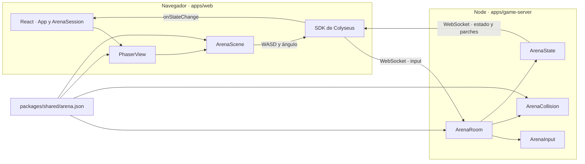
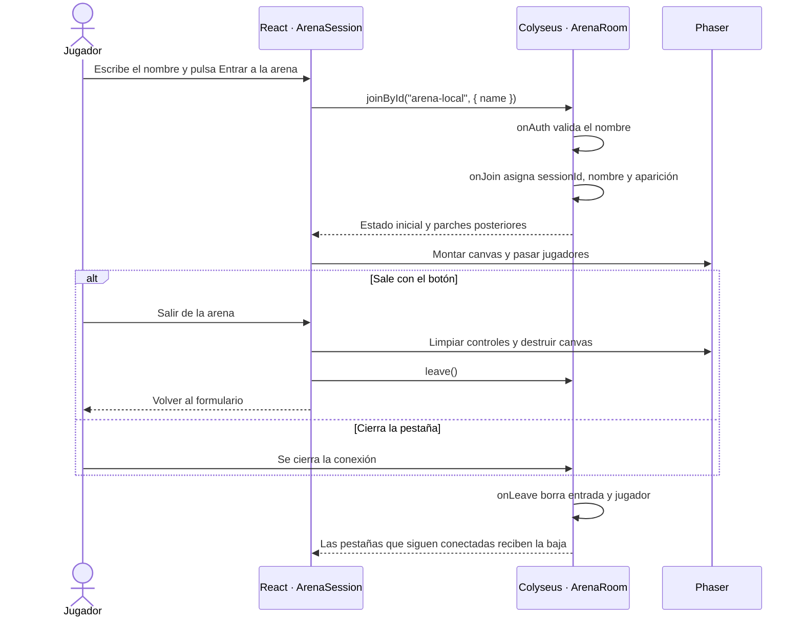
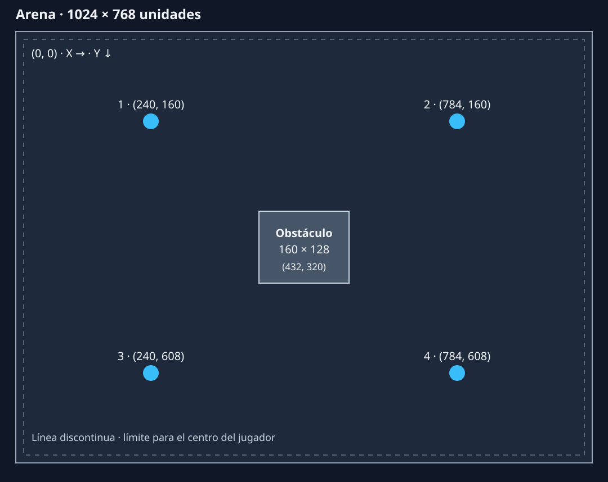
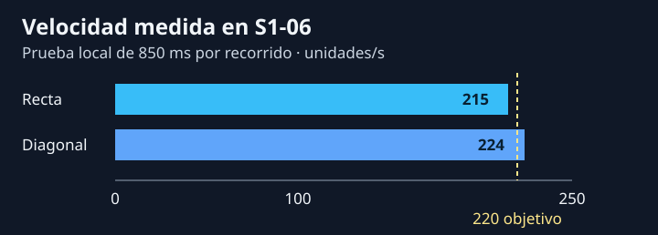

# Documentación técnica de TAP-WAR

Manual de la implementación local hasta S1-07. Actualizado el 11 de noviembre de 2026.

- [Arquitectura y arranque](#arquitectura-y-arranque)
- [Mapa de archivos](#mapa-de-archivos)
- [Entrada y salida de la sala](#entrada-y-salida-de-la-sala)
- [Movimiento, apuntado y sincronización](#movimiento-apuntado-y-sincronización)
- [Geometría y colisiones](#geometría-y-colisiones)
- [Verificación y diagnóstico](#verificación-y-diagnóstico)
- [Cómo mantener el manual](#cómo-mantener-el-manual)

## Arquitectura y arranque

TAP-WAR es un monorepo con dos aplicaciones Node y una carpeta de datos compartidos. **React** maneja la interfaz y el ciclo de la conexión. **Phaser** captura los controles y dibuja la arena. **Colyseus** valida las entradas, decide posiciones y colisiones, y distribuye el estado oficial. Cada pestaña entra a la misma sala local y obtiene un identificador de sesión propio.



Usa Node.js 24. Las versiones principales están en el [README](README.md#tecnologías-y-versiones) y las exactas en los lockfiles. El servidor usa Colyseus **0.17.11**, el navegador usa `@colyseus/sdk` **0.17.43** y el esquema usa `@colyseus/schema` **4.0.31**. Cada aplicación instala sus dependencias con `npm ci` desde su propia carpeta.

Desde la raíz, abre dos terminales de PowerShell:

| Terminal del servidor | Terminal del cliente |
| --- | --- |
| `Set-Location apps/game-server` | `Set-Location apps/web` |
| `npm ci` | `npm ci` |
| `npm run dev` | `npm run dev` |

Colyseus escucha en `127.0.0.1:2567`. Su ruta `/health` devuelve `{"ok":true}`. Abre en dos pestañas la URL que muestre Vite. Escribe un nombre temporal y pulsa **Entrar a la arena** en cada una. El puerto de Vite sirve la interfaz y el 2567 sirve la conexión de juego.

## Mapa de archivos

### Servidor y datos compartidos

| Archivo | Responsabilidad |
| --- | --- |
| [apps/game-server/src/index.ts](apps/game-server/src/index.ts) | Registra el tipo de sala `arena`, expone `/health`, inicia el servidor y crea la sala local. |
| [apps/game-server/src/rooms/ArenaRoom.ts](apps/game-server/src/rooms/ArenaRoom.ts) | Valida nombres, gestiona altas y bajas, asigna apariciones, guarda las últimas entradas válidas y ejecuta la simulación. |
| [apps/game-server/src/rooms/ArenaState.ts](apps/game-server/src/rooms/ArenaState.ts) | Define el esquema de red. `Player` contiene `id`, `name`, `x`, `y` y `aimAngle`. `ArenaState` almacena jugadores por ID en un `MapSchema`. |
| [apps/game-server/src/rooms/ArenaInput.ts](apps/game-server/src/rooms/ArenaInput.ts) | Recibe un valor desconocido y devuelve los tres campos validados o `null`. |
| [apps/game-server/src/rooms/ArenaCollision.ts](apps/game-server/src/rooms/ArenaCollision.ts) | Calcula una posición válida según el radio, los bordes y los rectángulos. |
| [packages/shared/arena.json](packages/shared/arena.json) | Define ancho, alto, radio, puntos de aparición y obstáculos para ambas aplicaciones. |
| [package.json](apps/game-server/package.json) y [package-lock.json](apps/game-server/package-lock.json) | Declaran las dependencias del servidor, el comando de desarrollo con `tsx watch` y la instalación reproducible. |
| [tsconfig.json](apps/game-server/tsconfig.json) y [.gitignore](apps/game-server/.gitignore) | Configuran TypeScript en modo NodeNext, el chequeo estricto y los decoradores de Colyseus. Git ignora las dependencias instaladas. |

### Cliente web

| Archivo | Responsabilidad |
| --- | --- |
| [apps/web/index.html](apps/web/index.html) | Declara `#root`, carga el favicon e inicia el módulo `main.tsx`. |
| [apps/web/src/main.tsx](apps/web/src/main.tsx) | Monta React en `#root` bajo `StrictMode` e importa los estilos globales. |
| [apps/web/src/App.tsx](apps/web/src/App.tsx) | Muestra el formulario de nombre temporal y el estado de conexión. `ArenaSession` se une a la sala, escucha los parches y proporciona a Phaser el ID propio y el envío de entradas. |
| [apps/web/src/game/PhaserView.tsx](apps/web/src/game/PhaserView.tsx) | Crea una instancia de Phaser al entrar, pasa los jugadores a la escena y destruye el juego al desmontarse. Usa las dimensiones del JSON y escala el canvas con `FIT`. |
| [apps/web/src/game/ArenaScene.ts](apps/web/src/game/ArenaScene.ts) | Lee teclado y cursor, dibuja los obstáculos y sincroniza las figuras con el estado oficial. Cada etiqueta usa `Player.name`. |
| [index.css](apps/web/src/index.css) y [App.css](apps/web/src/App.css) | El primero aplica estilos globales. El segundo conserva estilos de la plantilla inicial y la aplicación actual no lo importa. |
| [public/](apps/web/public/) y [src/assets/](apps/web/src/assets/) | Contienen el favicon y recursos de la plantilla. La arena actual dibuja sus figuras en código. |
| [package.json](apps/web/package.json) y [package-lock.json](apps/web/package-lock.json) | Declaran React, Phaser, el SDK, las herramientas de desarrollo y los comandos de Vite, compilación y lint. |
| [vite.config.ts](apps/web/vite.config.ts) | Activa el plugin de React y permite servir `packages/shared/` durante el desarrollo. |
| [tsconfig.json](apps/web/tsconfig.json), [tsconfig.app.json](apps/web/tsconfig.app.json) y [tsconfig.node.json](apps/web/tsconfig.node.json) | Separan la configuración del navegador y la de Vite en Node. La del navegador permite importar el JSON de la arena. |
| [eslint.config.js](apps/web/eslint.config.js), [.gitignore](apps/web/.gitignore) y [README.md](apps/web/README.md) | Configuran el lint, las exclusiones de Git y los comandos del cliente. |

### Archivos del repositorio

| Ruta | Uso |
| --- | --- |
| [README.md](README.md) | Presentación, tecnologías y arranque rápido. |
| [docs/](docs/) | Contrato de red, pruebas de aceptación, acuerdos, arte, planificación y flujo del equipo. |
| [.github/](.github/) | Plantillas para describir tareas y verificar pull requests. |
| [prueba-phaser/](prueba-phaser/) | Práctica independiente. Su `index.html` carga Phaser y `juego.js` contiene la escena de aprendizaje. Su README describe cómo ejecutarla. |

## Entrada y salida de la sala



- `index.ts` crea la sala una vez al arrancar. `onCreate` le da el ID fijo `arena-local` y `autoDispose = false` la mantiene disponible aunque se vacíe.
- El máximo de participantes coincide con los cuatro puntos de aparición del JSON. `onJoin` elige el primero cuyo centro no coincide con la posición actual de otro jugador. Usa `client.sessionId` como clave y como `Player.id`.
- El formulario recorta espacios al enviar el nombre y limita el campo a 24 caracteres. El servidor vuelve a recortar el texto en `onAuth` y exige una cadena de 1 a 24 caracteres después del recorte. `onJoin` copia el valor validado a `Player.name`.
- `Player.name` es una etiqueta provisional y puede repetirse. El `sessionId` identifica al jugador en el mapa, sus entradas de movimiento y su figura en Phaser. El flujo usa un nombre de pantalla y carece de autenticación de cuentas.
- React entra por ID para apuntar siempre a la misma instancia. Mientras abre la sesión muestra **Conectando…** y al entrar muestra **Conectado** y el número de jugadores. Si la sala está llena, se rechaza el nombre o falla la conexión, `ArenaSession` llama a `onEnd` para volver al formulario y mostrar el aviso. Una desconexión durante la partida sigue el mismo recorrido. Al pulsar **Salir de la arena** también vuelve el formulario, con el nombre escrito y sin aviso. La reconexión automática está desactivada. Volver a entrar crea otra sesión.
- El efecto de React difiere el inicio a una microtarea y comprueba si sigue activo. Si la conexión termina de abrirse después de salir, el cliente la cierra. `PhaserView` también difiere el arranque y limpia los listeners y el temporizador al desmontarse.

## Movimiento, apuntado y sincronización

### Qué cruza la red

```json
{ "moveX": 1, "moveY": -1, "aimAngle": 0 }
```

El mensaje `input` expresa dirección y ángulo. Cada eje acepta `-1`, `0` o `1`. La derecha y abajo son positivas. El ángulo usa radianes en `[-π, π)`. El servidor obtiene la identidad de la conexión y solo extrae esos tres campos. Si falta alguno o su valor es inválido, descarta el mensaje entero. Si se adjuntan coordenadas, quedan fuera de la entrada validada.

```json
{ "id": "ejemplo", "name": "Luna", "x": 240, "y": 160, "aimAngle": 0 }
```

El estado oficial contiene un objeto como ese por jugador. Colyseus envía el estado inicial y después parches. `ArenaSession` convierte el mapa de jugadores en una lista. `applyPlayers` conserva una figura por ID, actualiza su posición y rotación, y destruye las figuras cuyos IDs ya no existen. El cliente renderiza el estado recibido directamente. El nombre viaja con el estado y se usa para dibujar la etiqueta de cada figura.

### Controles y simulación

1. `ArenaScene.startControls` lleva un conjunto de teclas presionadas. Resta A a D y W a S para obtener cada eje. Usa `getWorldPoint` para pasar del cursor en el canvas a coordenadas del mundo y calcula el ángulo desde el centro del jugador propio. Si los puntos coinciden, conserva el último ángulo.
2. Con foco, la escena envía la entrada cada 50 ms. Al soltar una tecla envía enseguida los ejes restantes. Al perder el foco u ocultar la pestaña borra las teclas y envía ambos ejes en cero.
3. `ArenaRoom.onMessage` valida antes de actualizar el reloj y el ángulo. `simulate` usa la última dirección vigente. Al vencer los 300 ms elimina esa entrada y conserva el ángulo sincronizado.
4. Cada paso calcula la distancia con el tiempo transcurrido. Dividir los dos ejes entre la longitud del vector mantiene la misma rapidez al ir en diagonal. La posición solo cambia después de resolver la colisión.

Fragmento de `ArenaRoom.ts` que registra una entrada válida:

```ts
const input = parseArenaInput(message)
const player = this.state.players.get(client.sessionId)
if (!input || !player) return

this.inputs.set(client.sessionId, {
    ...input,
    receivedAt: performance.now(),
})
player.aimAngle = input.aimAngle
```

| Reloj | Intervalo nominal | Responsabilidad |
| --- | --- | --- |
| Envío de entradas | 50 ms, 20 Hz | Phaser envía intención mientras la pestaña tiene foco. |
| Simulación | 1000 / 30 ms, 30 Hz | La sala integra el movimiento a 220 unidades/s y resuelve colisiones. |
| Publicación | 50 ms, 20 Hz | Colyseus transmite los cambios del esquema. |
| Caducidad | 300 ms | El siguiente paso de simulación deja de aplicar una entrada vencida. |

Consulta las reglas del protocolo y los ejemplos de valores inválidos en el [contrato cliente-servidor](docs/contrato-cliente-servidor.md).

## Geometría y colisiones



El origen es la esquina superior izquierda. El rectángulo usa su esquina superior izquierda como referencia, y el jugador usa el centro de su círculo de radio **14**. El obstáculo empieza en `(432, 320)` y mide **160 × 128**. El centro del jugador queda entre `14` y `1010` en X y entre `14` y `754` en Y. Los cuerpos de los jugadores pueden superponerse.

`moveInsideArena` divide el desplazamiento en pasos de como máximo medio radio. Limita el centro a los bordes y prueba X e Y por separado para permitir el deslizamiento. Para cada rectángulo obtiene el punto más cercano al centro del círculo. Si la distancia al cuadrado es menor que el radio al cuadrado, el paso en ese eje se descarta. El contacto tangente está permitido.

```ts
const nextX = clamp(x + stepX, radius, arena.width - radius)
if (!overlapsObstacle(nextX, y)) x = nextX

const nextY = clamp(y + stepY, radius, arena.height - radius)
if (!overlapsObstacle(x, nextY)) y = nextY
```

En Phaser, `setOrigin(0)` alinea cada rectángulo con la misma esquina que usa el servidor. Cuando se cambie el mapa, edita `arena.json` y comprueba las apariciones, los bordes y el obstáculo en dos pestañas.

## Verificación y diagnóstico



Las dos mediciones se hicieron en recorridos de 850 ms el 11 de noviembre de 2026. La gráfica redondea los resultados. La verificación en dos pestañas y los casos de entradas inválidas están documentados en la [prueba local de S1-06](docs/prueba-sprint-1.md#prueba-local-de-s1-06). Las pruebas del sprint entre redes distintas tienen su propia tabla en ese mismo archivo.

| Si observas… | Comprueba… |
| --- | --- |
| Vite abre pero la arena no conecta | `/health`, el puerto en `index.ts` y la URL en `App.tsx`. |
| Hay conexión pero falta el canvas | El estado de `ArenaSession`, el contenedor de `PhaserView` y los errores de la consola. |
| El jugador no responde a WASD | El foco de la pestaña, el ID propio y que salga un mensaje `input` por WebSocket. |
| La línea de apuntado gira en una pestaña pero no en la otra | El `aimAngle` validado en la sala y la aplicación del parche en `applyPlayers`. |
| El dibujo del obstáculo difiere de la colisión | Los imports de `arena.json`, el origen del rectángulo y el radio del círculo. |

Desde `apps/web`, usa `npm run lint` y `npm run build`. Desde `apps/game-server`, ejecuta `node ../web/node_modules/typescript/bin/tsc -p .` después de instalar las dependencias de ambas aplicaciones.

## Cómo mantener el manual

- Si cambia un mensaje, esquema o frecuencia, actualiza su fragmento aquí y la regla en el [contrato](docs/contrato-cliente-servidor.md).
- Si cambia el mapa, actualiza el [plano](docs/diagramas/arena.svg) a partir de `arena.json` y repite las pruebas de bordes y apariciones.
- Si se agrega un archivo que participa en el juego, inclúyelo en el mapa de archivos y en el diagrama si cambia el flujo.
- Si cambia el arranque o una versión de dependencia, comprueba los comandos y la tabla del [README](README.md).
- Registra el alcance, los resultados y la fecha en la [prueba de aceptación](docs/prueba-sprint-1.md). Para los pendientes del sprint, consulta [GitHub Issues](https://github.com/EMSiiU/TAP-WAR/issues) y el [plan de la semana](docs/semana-1.md).
